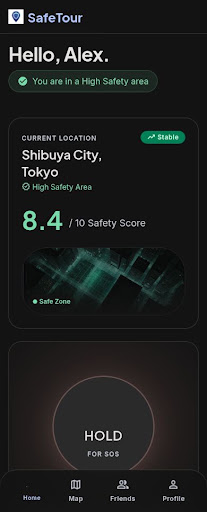
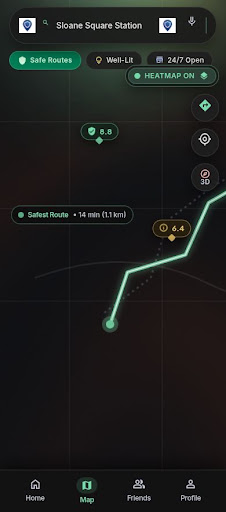
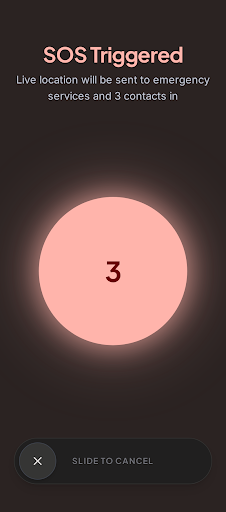
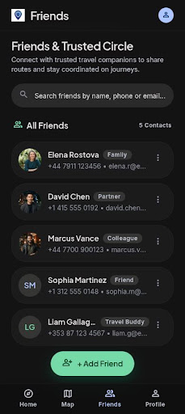
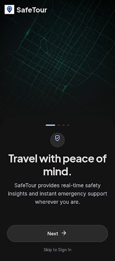

<div align="center">

# SafeTour

**A Zero-Cost, Community-Driven Personal Safety Radar for Newcomers in Bengaluru**

[](https://flutter.dev)
[](https://dart.dev)
[](https://www.openstreetmap.org)
[](https://supabase.com)
[](LICENSE)
[](CONTRIBUTING.md)

</div>

---

> [!WARNING]
> ### Project Status: Active Prototyping / MVP
> **SafeTour is actively under development and not yet in its final release state.**  
> Features, architecture, and UI designs are undergoing continuous refinement. We welcome teammate collaboration, ideas, and pull requests. Check out our [Roadmap](#roadmap--whats-next) and [Contributing Guide](CONTRIBUTING.md) to get involved.

---

## About SafeTour

Navigating a massive, unfamiliar metropolis like **Bengaluru** can be overwhelming for newcomers, students, migrant workers, and tourists—especially when traveling alone or during late hours. Existing safety and mapping solutions often rely on expensive proprietary APIs (such as Google Maps), require constant high-speed data, or lack hyper-local neighborhood context (street lighting, crowd density, day vs. night safety scores).

**SafeTour** is engineered as a **lightweight, offline-first, zero-cost personal safety companion**:
- **Zero API Bills**: Leverages OpenStreetMap tile servers with a custom dark-mode cartography filter—completely free with zero billing risk or API quotas.
- **Hyper-Local Context**: Analyzes day vs. night safety across **100+ Bengaluru localities**, rating lighting, crowd density, and providing safety tips.
- **Offline-First Reliability**: Works 100% out-of-the-box using pre-bundled local safety datasets, ensuring life-saving navigation even when mobile connectivity drops.
- **Instant Emergency Response**: One-tap SOS countdown with loud audible sirens and automatic emergency coordination.

---

## App Highlights and UI Gallery

| Home Safety Dashboard | Interactive Safety Map | Emergency SOS Siren |
| :---: | :---: | :---: |
|  |  |  |
| *Real-time locality score and radar* | *Free OSM map with zone heatmaps* | *Pulsating SOS button and countdown* |

| Friends and Companions | User Profile and Security | Onboarding Walkthrough |
| :---: | :---: | :---: |
|  |  |  |
| *Safety check-ins and network* | *Account preferences and emergency info* | *Quick newcomer intro* |

---

## Core Features

### 1. Zero-Cost Interactive Safety Map
- **OpenStreetMap Integration**: Powered by `flutter_map` and `latlong2`—requires no Google Maps API keys or credit card billing.
- **Safety Zones Visualizer**: Dynamic circular polygons indicating safety levels across Bengaluru (Green = Safe, Amber = Moderate Caution, Red = High Caution).
- **Day / Night Dynamic Mode**: Toggle between daytime and nighttime safety scores to reflect changing street conditions.
- **Live User Geolocation**: Tracks real-time GPS coordinates via `geolocator` and identifies the nearest safety zone with distance metrics.

### 2. Comprehensive Bengaluru Safety Directory
- **100 Pre-Bundled Localities**: Covers all major Bengaluru hubs (Indiranagar, Koramangala, Whitefield, HSR Layout, MG Road, Electronic City, Jayanagar, etc.).
- **Detailed Metrics**:
  - Daytime Safety Score (1.0 - 10.0)
  - Nighttime Safety Score (1.0 - 10.0)
  - Street Lighting Rating (1 - 10)
  - Crowd and Pedestrian Density (1 - 10)
  - Actionable Neighborhood Safety Tips

### 3. Rapid SOS Emergency Subsystem
- **Breathing Animated SOS Button**: Designed for quick access in stressful moments.
- **3-Second Cancellation Window**: Prevents accidental false alarms.
- **Audible Siren Alert**: High-decibel audio warning to deter potential threats and alert bystanders.
- **Automated Dispatch**: Coordinates user's exact latitude and longitude for emergency contact SMS and police notifications.

### 4. Bengaluru Emergency Helplines
Direct one-tap dialer for critical regional emergency services:
- **112**: Karnataka Integrated Emergency Helpline
- **1091**: Karnataka Women Helpline
- **100**: Bengaluru City Police Control Room
- **1930**: National Cyber Crime Reporting Portal
- **108**: Emergency Ambulance Service
- **Custom Contacts**: Manage personal trusted emergency contacts.

### 5. Companion and Friends Network
- Shared safety status with trusted friends.
- Rapid check-in verification when arriving at destinations.

---

## Architecture and Tech Stack

```
SafeTour/
├── android/                 # Android native runner and permissions
├── ios/                     # iOS native runner and Info.plist permissions
├── web/                     # Flutter Web shell
├── docs/images/             # UI screenshots and documentation assets
├── supabase/
│   └── migrations/          # PostgreSQL 15+ schema with Row Level Security (RLS)
├── lib/
│   ├── main.dart            # Startup gate, theme initialization and auth resolution
│   ├── core/
│   │   ├── constants/       # App constants, URLs, Supabase configuration
│   │   ├── theme/           # Immersive dark UI theme, colors, typography
│   │   └── utils/           # Haversine distance calculator, scoring formulas
│   ├── data/
│   │   ├── local/           # 100 pre-bundled Bengaluru localities (zero-network mode)
│   │   ├── models/          # SafetyZone, EmergencyContact, SOSEvent models
│   │   └── repositories/    # Hybrid offline/cloud data repositories
│   └── features/
│       ├── auth/            # Sign in, sign up, profile setup
│       ├── directory/       # Searchable locality index
│       ├── emergency/       # Helplines and contact manager
│       ├── friends/         # Companion check-in network
│       ├── home/            # Dashboard radar and safety score
│       ├── map/             # OSM map view, locality bottom sheet
│       ├── navigation/      # Bottom navigation shell
│       ├── onboarding/      # Walkthrough for new users
│       ├── profile/         # Profile management
│       └── sos/             # SOS emergency dialog and countdown
└── test/                    # Unit and widget test suites
```

| Layer | Technology | Details |
| :--- | :--- | :--- |
| **Framework** | [Flutter 3.x](https://flutter.dev) | Cross-platform mobile application |
| **Language** | [Dart 3.x](https://dart.dev) | Null-safe modern language |
| **Mapping** | [flutter_map](https://pub.dev/packages/flutter_map) + [latlong2](https://pub.dev/packages/latlong2) | OpenStreetMap (OSM) tile rendering |
| **Location** | [geolocator](https://pub.dev/packages/geolocator) | Accurate device GPS positioning |
| **Backend & Auth** | [Supabase](https://supabase.com) | PostgreSQL 15+, Row-Level Security, Auth |
| **Local Storage** | [shared_preferences](https://pub.dev/packages/shared_preferences) | Offline caching and local persistence |

---

## Getting Started

### 1. Prerequisites
- [Flutter SDK](https://docs.flutter.dev/get-started/install) (`>= 3.0.0 < 4.0.0`)
- Git
- VS Code or Android Studio with Flutter extensions

### 2. Clone the Repository
```bash
git clone https://github.com/SafeTour26/SafeTour.git
cd SafeTour
```

### 3. Install Dependencies
```bash
flutter pub get
```

### 4. Configure Environment Variables
SafeTour connects to Supabase when credentials are provided, but can also run completely offline without any keys.

1. Copy the sample environment file:
   ```bash
   cp .env.example .env
   ```
2. Request credentials from the team lead, or enter your Supabase project keys in `.env`:
   ```env
   SUPABASE_URL=https://your-project.supabase.co
   SUPABASE_ANON_KEY=your-supabase-anon-key
   SUPABASE_SERVICE_ROLE_KEY=your-supabase-service-role-key # Seed scripts only
   ```
   > [!NOTE]
   > Security Notice: `.env` is ignored in `.gitignore`. Never commit keys to GitHub.

### 5. Run the App

#### Via VS Code (Recommended)
1. Open the project in VS Code.
2. Open the Run and Debug panel (`Ctrl+Shift+D` / `Cmd+Shift+D`).
3. Select **SafeTour (with .env)** or **SafeTour (Offline Mode)** and press **F5**.

#### Via Terminal
- **With live backend:**
  ```bash
  flutter run --dart-define-from-file=.env
  ```
- **In offline-first mode:**
  ```bash
  flutter run
  ```

---

## Testing and Code Quality

Before opening a pull request, run:

```bash
# Verify formatting
dart format --output=none --set-exit-if-changed .

# Run static analysis
flutter analyze

# Run unit and widget tests
flutter test
```

---

## Database Setup and Seeding (Supabase)

If you are setting up your own Supabase instance:
1. Open the **SQL Editor** in your Supabase Dashboard.
2. Execute the migration script at [`supabase/migrations/20260913_initial_schema.sql`](supabase/migrations/20260913_initial_schema.sql).
3. Populate the 100 Bengaluru localities using the Python seeder:
   ```bash
   python3 seed_safety_zones.py
   ```
   *(Ensure `SUPABASE_SERVICE_ROLE_KEY` is configured in your `.env` beforehand).*

---

## Roadmap / What's Next

SafeTour is under active development. Here are high-priority features currently in progress:

- [ ] **Turn-by-Turn Safe Routing**: Routing algorithm that penalizes poorly lit or isolated streets at night.
- [ ] **Crowdsourced Hazard Reporting**: Community pins for broken streetlights, aggressive stray packs, or isolated alleys.
- [ ] **Geofenced Background Alerts**: Proactive notifications when walking into lower-rated safety zones.
- [ ] **Kannada and Hindi Localization**: Multi-language support to empower non-English speaking residents and visitors.
- [ ] **Direct SMS Gateway**: Background emergency SMS dispatch with live OpenStreetMap tracking links.
- [ ] **Multi-City Expansion**: Expanding safety databases to Hyderabad, Mumbai, Delhi, and Chennai.

---

## Contributing

We welcome contributions from teammates and the open-source community.

1. Read our **[Contributing Guidelines](CONTRIBUTING.md)**.
2. Review our **[Code of Conduct](CODE_OF_CONDUCT.md)**.
3. Check existing issues or submit a [Feature Request](.github/ISSUE_TEMPLATE/feature_request.md).
4. Create a feature branch (`git checkout -b feature/amazing-feature`).
5. Commit and open a Pull Request.

---

## License

This project is licensed under the **MIT License** — see the [LICENSE](LICENSE) file for details.

---

<div align="center">
Built for a safer, more welcoming Bengaluru.
</div>
